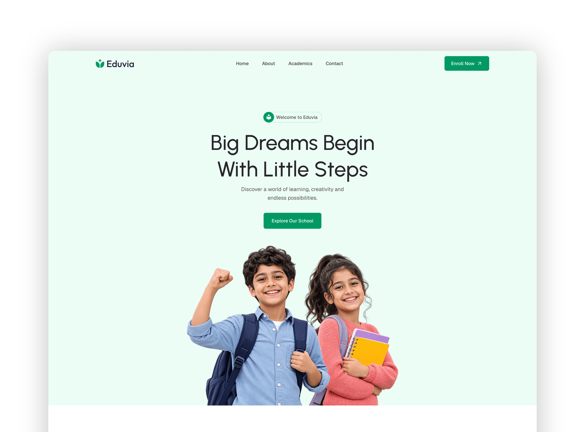
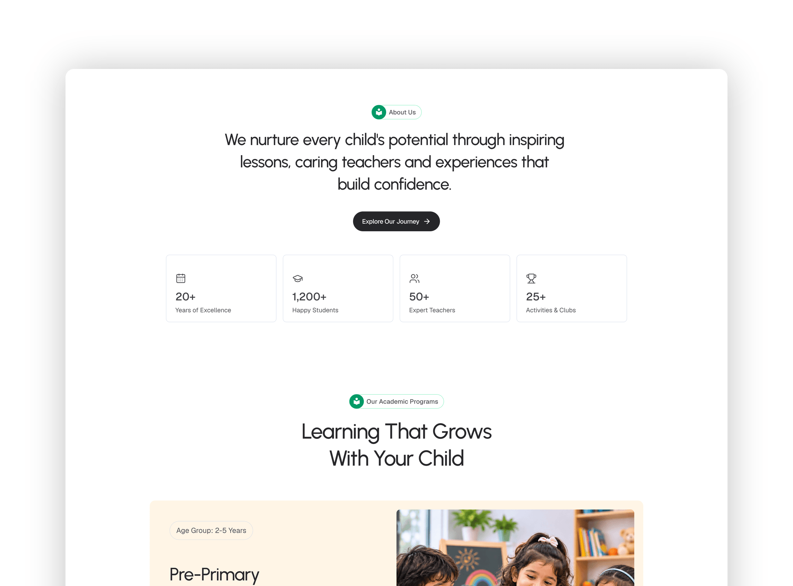
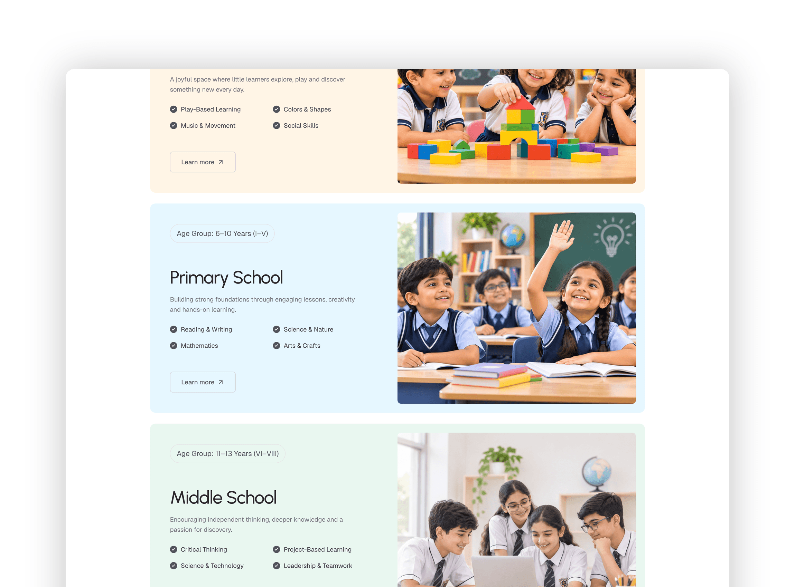
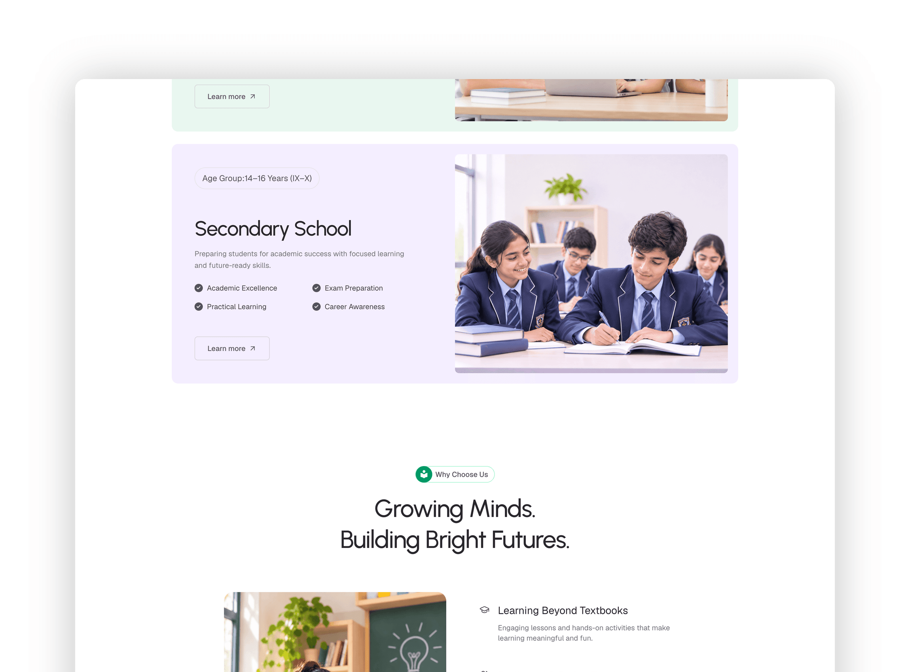
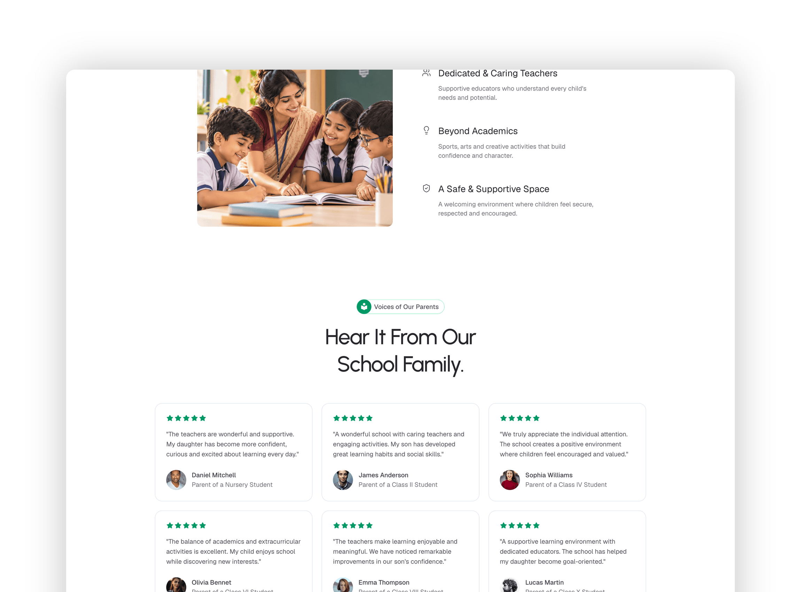
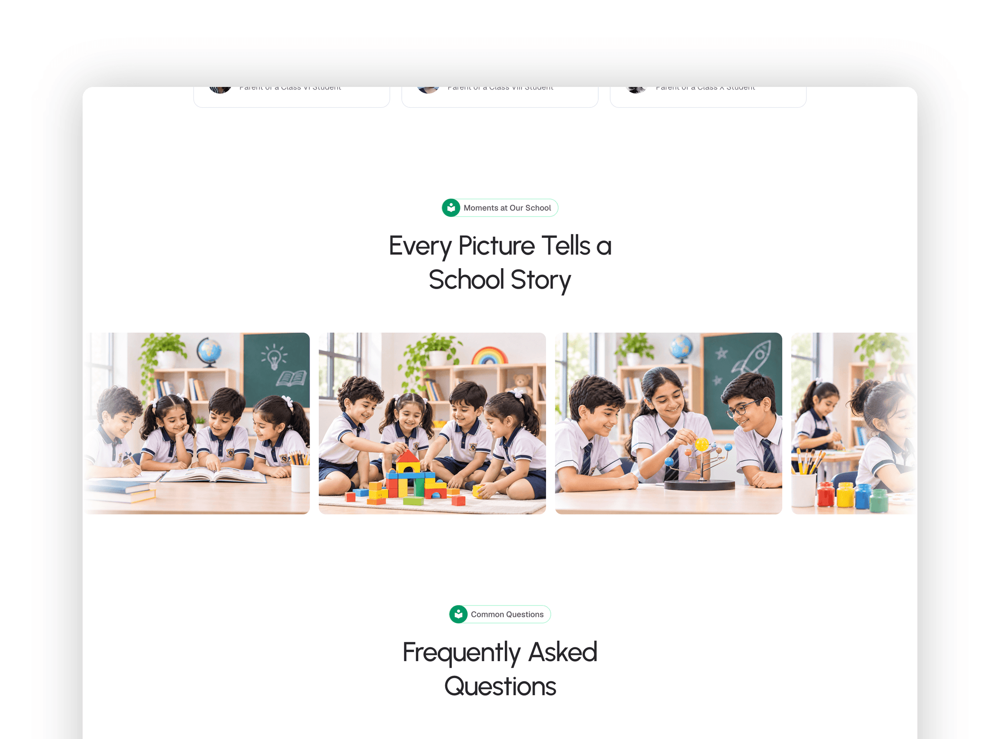
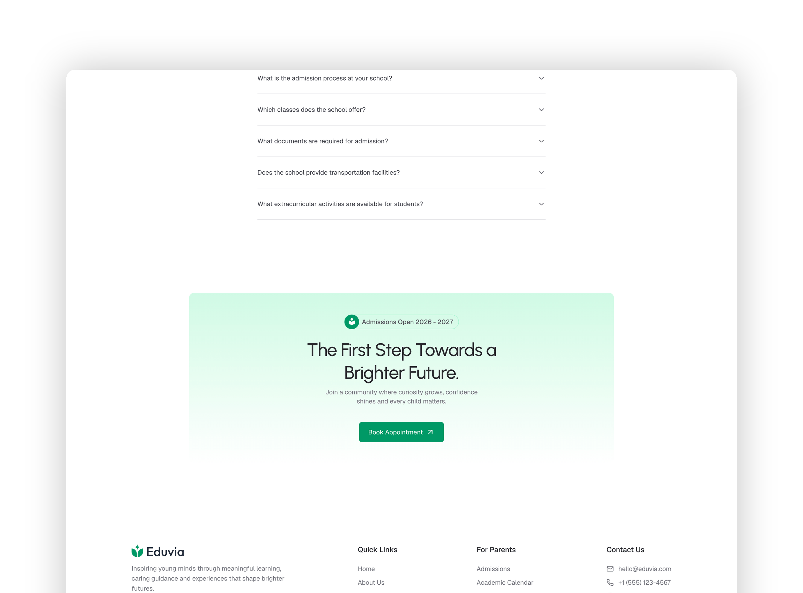
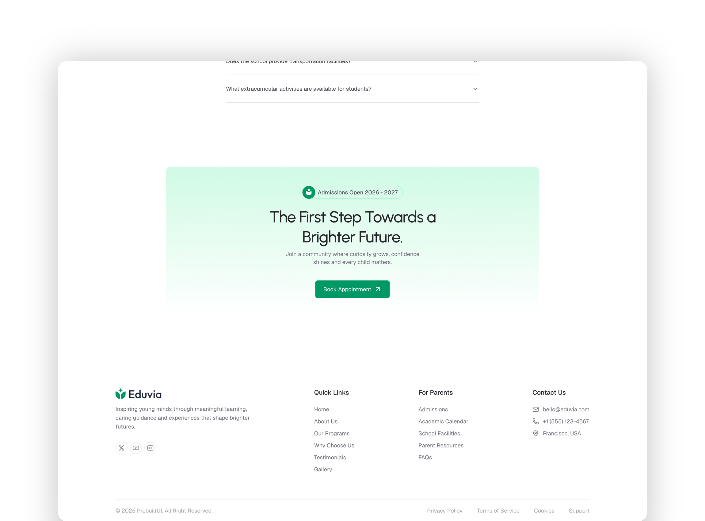

# Eduvia - School Website Template

Multi-Tier Academic Programs, Interactive Impact Statistics, Core Values and Advantages, Dynamic Campus Life Gallery, Verified Parent Testimonials, Interactive Admission FAQ Accordion and Admissions Call-to-Action Section.

**Live Demo:**
[https://eduvia.prebuiltui.com](https://eduvia.prebuiltui.com?utm_source=github&utm_medium=readme)

**More Details:**
[https://prebuiltui.com/react-templates/school-website-template](https://prebuiltui.com/react-templates/school-website-template?utm_source=github&utm_medium=readme)
